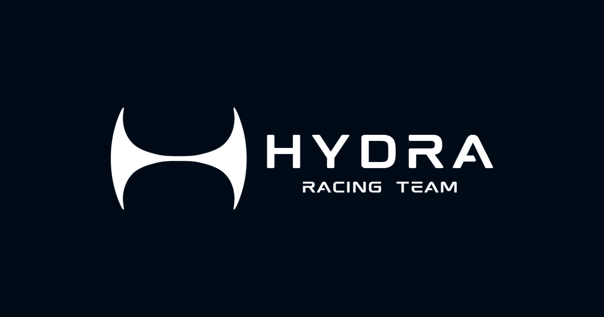

  

<h3 align="center"><em>Drive Clean, Reach Far.</em></h3>

  Team studentesco della <strong>Sapienza Università di Roma</strong> che progetta un prototipo a idrogeno 
  con celle a combustibile per la <strong>Shell Eco-marathon 2026</strong>.

  
  
  
  

---

### 🚗 Il progetto

Il nostro obiettivo non è la velocità pura, ma l'**efficienza energetica**: percorrere il massimo chilometraggio consumando la minima quantità di carburante.

<table>
  <tr>
    <td width="33%" valign="top">
      <strong>⚡ Fuel cell a idrogeno</strong> 
      Il motore elettrico è alimentato da celle a combustibile a idrogeno: energia pulita, zero emissioni allo scarico.
    </td>
    <td width="33%" valign="top">
      <strong>🪶 Efficienza prima di tutto</strong> 
      Ogni scelta progettuale riduce peso, consumi e resistenza aerodinamica.
    </td>
    <td width="33%" valign="top">
      <strong>🏁 Shell Eco-marathon 2026</strong> 
      La competizione internazionale in cui i team universitari si sfidano sui prototipi più efficienti al mondo.
    </td>
  </tr>
</table>

**Dal laboratorio alla gara:** `Progettazione` → `Costruzione` → `Testing` → `Gara` (categoria *Hydrogen fuel cell*)

### 💻 Repository

| Repo | Contenuto |
|---|---|
| [**firmware**](https://github.com/SapienzaHydra/firmware) | Elettronica di bordo: cruscotto su ESP32, librerie condivise tra le schede, prototipi (controllo motore, volante). PlatformIO + Wokwi |

### 👥 Il team

**25 studenti, un obiettivo comune.** Un team multidisciplinare diviso in tre aree:

- **Ingegneria** — meccanica, elettronica, fuel cell, aerodinamica, simulazioni e testing
- **Management** — coordinamento, fundraising, relazioni con sponsor e istituzioni
- **Comunicazione** — brand identity, social, sito web, eventi

### 🤝 Partner

Officina Mazzarini · SolidWorks · PCBWay · Bike House · Notion · Sapienza Università di Roma

Vuoi sostenere il progetto? [Diventa sponsor](https://sapienzahydra.com/it/sponsor/).

### 🚀 Join the HYDRA

Sei uno studente della Sapienza e vuoi lavorare su un veicolo a idrogeno vero? Scopri il [recruiting](https://sapienzahydra.com/it/recruiting/) o scrivici a [info@sapienzahydra.com](mailto:info@sapienzahydra.com).

<strong>Come contribuire al codice</strong>

1. Chiedi a un admin di essere aggiunto all'organizzazione e al team giusto.
2. Lavora su un branch e apri una Pull Request verso `main`.
3. Si fa merge solo con la CI verde.

---

  📍 Via Eudossiana 18, 00184 Roma · Sapienza Università di Roma

