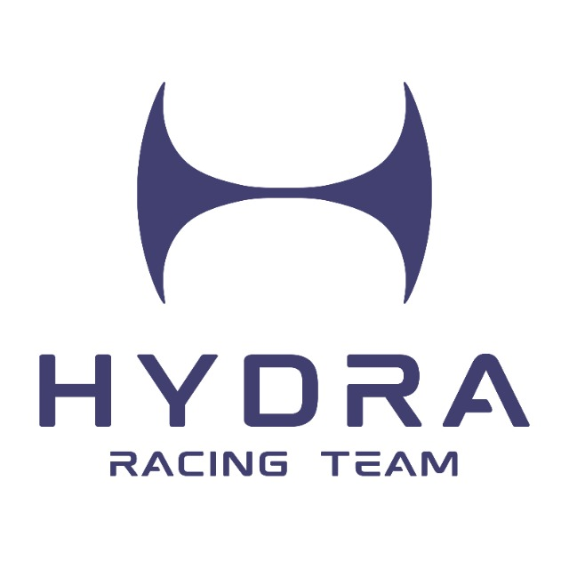

  

<h3 align="center">Hydra Racing Team</h3>

Il veicolo a idrogeno della Sapienza Università di Roma

---

### Repository

| Repo | Contenuto |
|---|---|
| **firmware** | Firmware di bordo (ESP32, PlatformIO): cruscotto e librerie condivise tra le schede |

### Come contribuire

1. Chiedi a un admin di essere aggiunto all'organizzazione.
2. Lavora su un branch e apri una Pull Request verso `main`.
3. Si fa merge solo con la CI verde.
